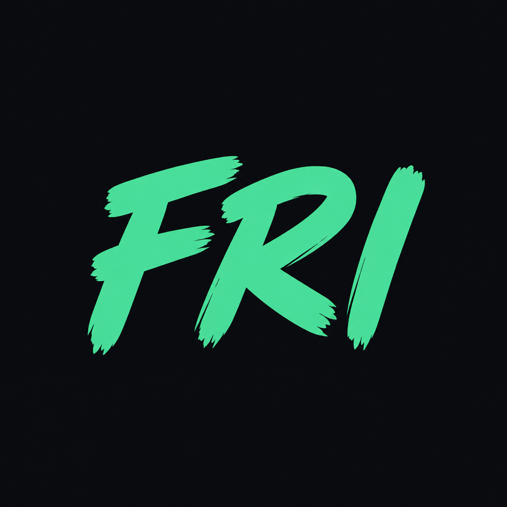
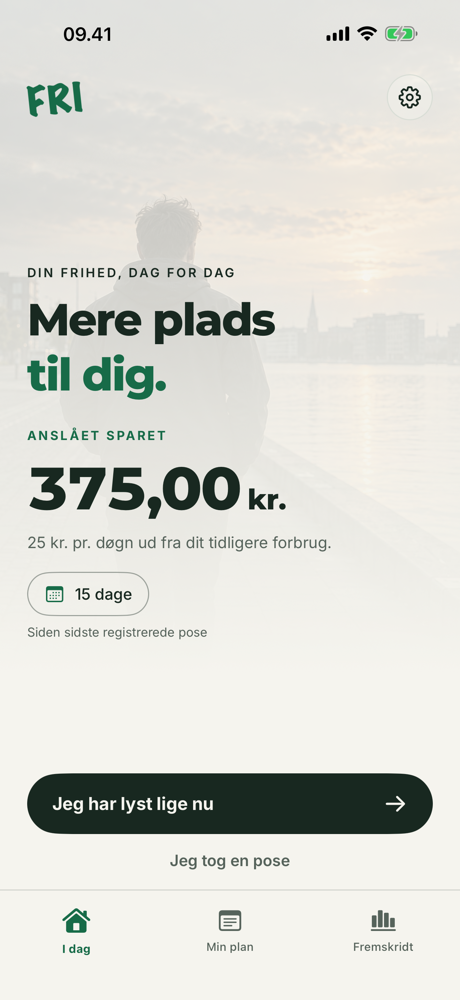
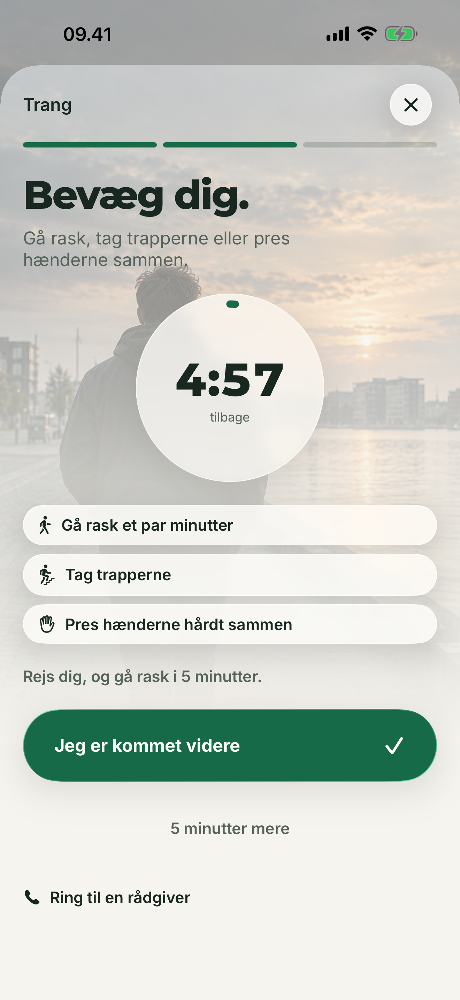
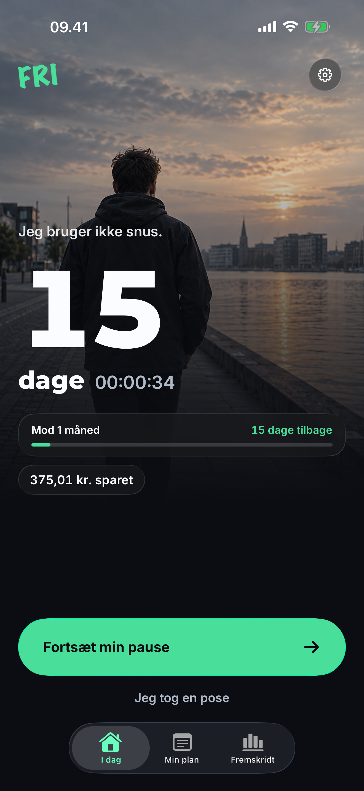
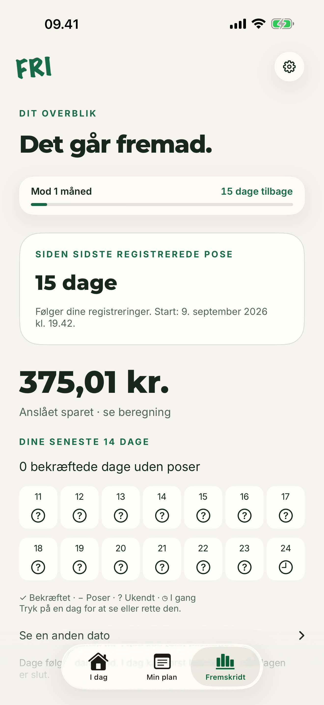
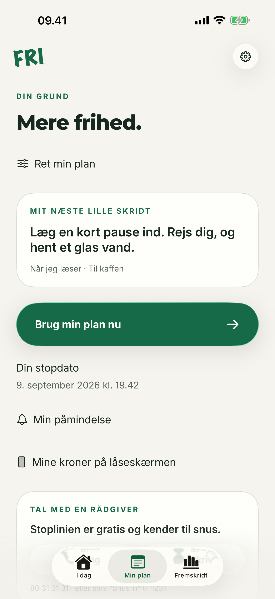
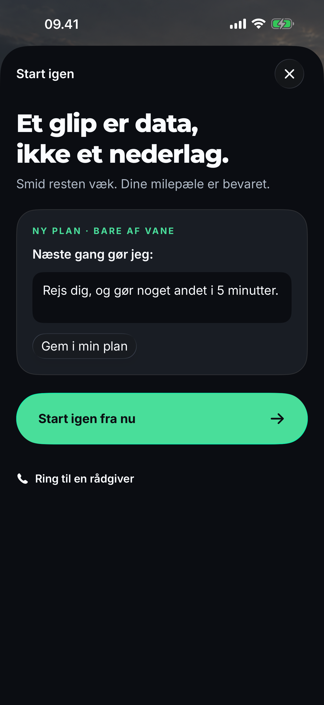

<p align="center">
  
</p>

<h1 align="center">FRI — Stop med snus</h1>

<p align="center"><strong>Mere plads til dig. Én dag ad gangen.</strong></p>
<p align="center">A free, offline iPhone app for quitting snus and nicotine pouches.<br>Built in SwiftUI. Written for Danish everyday life.</p>
<p align="center"><strong>iOS 26+</strong> · <strong>SwiftUI + WidgetKit</strong> · <strong>No account</strong> · <strong>No ads or analytics</strong></p>

<p align="center">
  <a href="#the-app">Features</a> ·
  <a href="#run-locally">Run locally</a> ·
  <a href="#privacy-and-data">Privacy</a> ·
  <a href="#project-status">Project status</a>
</p>

## A little more freedom

FRI means “free” in Danish. The app brings together a personal quit plan, a clear view of progress, and something practical to do when a craving arrives. No signup, subscription, or feed to keep up with.

<table>
  <tr>
    <td align="center"><br><strong>Today</strong></td>
    <td align="center"><br><strong>Help right now</strong></td>
    <td align="center"><br><strong>After dark</strong></td>
  </tr>
</table>

*Actual simulator screenshots using isolated demo data. The interface is in Danish.*

## The app

### Progress you can understand

Follow the time since your last recorded pouch, estimated savings in Danish kroner, and milestones along the way. The 14-day calendar distinguishes explicitly confirmed pouch-free days, recorded use, and days you have not checked in. Missing information stays unknown.

Made a mistake? Correct or undo a record. Historical prices and previous milestones are preserved.

### A plan that fits your life

Set your usual consumption, tin price, quit date, motivation, and difficult situations. Give each situation a specific action to try. Onboarding saves your draft, and your plan stays editable. Local reminders are optional and off until requested.

### Support when a craving arrives

One tap opens a five-minute **Stop → Move → Surf** flow. The timer keeps track of elapsed time even when you close the app. Record what helped, or return to your plan after a pouch without losing your history.

<table>
  <tr>
    <td align="center"><br><strong>Your progress</strong></td>
    <td align="center"><br><strong>Your plan</strong></td>
    <td align="center"><br><strong>Your next step</strong></td>
  </tr>
</table>

Also included: Lock Screen widgets with a discreet mode, light/dark/system appearance, backup export and import, local recovery, and data deletion.

## Run locally

You need a Mac with **Xcode 26 or newer** and an **iOS 26+ iPhone simulator**. The app targets iPhone only and has no third-party runtime dependencies.

```sh
git clone https://github.com/jenskk2000/fri.git
cd fri
open ios/FRI.xcodeproj
```

In Xcode, select the **FRI** scheme, choose an iPhone simulator, and run. A fresh installation starts onboarding.

For a physical iPhone, select your own Apple Developer team and configure app, widget, and shared App Group identifiers. Update both `ios/project.yml` and `JourneyArchive.group` when changing the App Group. See the [device and distribution setup](release/APP-STORE.md).

The Xcode project is checked in. You only need [XcodeGen](https://github.com/yonaskolb/XcodeGen) when adding source files or changing project settings:

```sh
xcodegen generate --spec ios/project.yml
```

### Tests and release checks

```sh
# Domain tests: calculations, dates, history, migration, and recovery
swift test

# Configuration/assets checks and an unsigned Release archive
sh release/preflight.sh

# Regenerate App Store screenshots from isolated demo data
sh release/screenshots.sh
```

Run the **FRI** scheme's UI tests in Xcode with **Product → Test**. Automated UI tests use separate storage; preserve the normal simulator archive because it may contain manual edits.

The release preflight intentionally fails while the public support/privacy pages contain placeholders. Passing an unsigned build does not verify distribution signing or real-device behavior.

## Privacy and data

FRI has no backend, account system, analytics, advertising, or third-party SDKs. The app and widget share an on-device JSON archive with atomic writes and a previous-version recovery copy. Data leaves that archive only through user-controlled actions or system facilities, such as exporting a backup or iPhone backups.

Notifications are local and opt-in. Exported backups contain personal history and notes; do not attach them to public GitHub issues.

Savings are a **consumption estimate**, based on the price and quantity you enter. They are not a bank balance and exclude whole-tin purchases and nicotine replacement expenses. Time since a recorded pouch is not verified abstinence. FRI offers habit support, not individual medical advice.

## Project status

**Pre-release.** This repository contains the app, widgets, tests, screenshot set, and release documentation. It does not currently provide an App Store download.

On **28 September 2026**, all **56 core tests passed** and an **unsigned Release archive built successfully**. Those checks do not certify the UI, accessibility, signing, or TestFlight readiness.

Remaining release work includes public privacy/support details, an in-app technical support contact, signed-device validation, the [real-iPhone checklist](release/DEVICE-CHECK.md), and a TestFlight beta. See the [release guide](release/APP-STORE.md) for the submission workflow.

## Inside the repository

| Path | Contents |
| --- | --- |
| [`ios/App`](ios/App) | SwiftUI screens, onboarding, settings, and local state |
| [`ios/Shared`](ios/Shared) | Foundation domain models, calculations, and archive storage |
| [`ios/Widgets`](ios/Widgets) | WidgetKit extension |
| [`Tests/FRICoreTests`](Tests/FRICoreTests) | Swift Package domain tests |
| [`ios/UITests`](ios/UITests) | UI journeys and screenshot capture |
| [`release`](release) | Release checks, screenshots, and App Store material |
| [`site`](site) | Static privacy and support page drafts |
| [`docs`](docs) | Product scope, design decisions, and technical notes |
| [`verification`](verification) | Dated verification reports and captures, including earlier designs |

For calculation rules, time zones, storage migration, debug arguments, and asset provenance, see [Technical notes](docs/TECHNICAL-NOTES.md). The [focused product plan](docs/FOCUSED-CORE-PLAN.md) explains the three-feature scope.

## Feedback

Bug reports and focused suggestions are welcome through [GitHub Issues](https://github.com/jenskk2000/fri/issues). Include your iOS version, steps to reproduce, and what you expected. Use demo data for screenshots and omit private notes or backups.

## Credits and licensing

Built with SwiftUI and WidgetKit. Bundled typefaces are **Inter** and **Montserrat**, with their [SIL Open Font Licenses](ios/App/Fonts) included. The waterfront artwork and app icon were generated with ImageGen; see the [asset notes](design/dark-editorial/ASSET-PROMPTS.md).

No open-source license has been granted for the app code or artwork. Public availability of this repository does not change their copyright status. Bundled fonts retain their own licenses.
